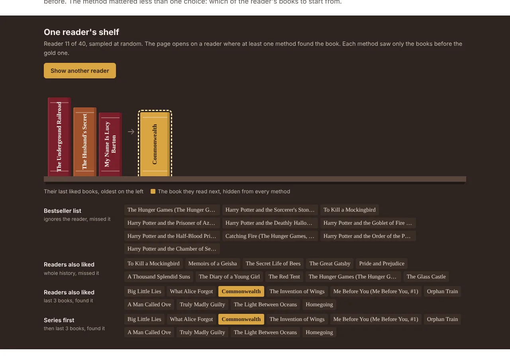

# Recommendation Lab

**What makes "readers also liked" work? A bestseller list, item similarity and a taste profile model, tested on 6 million book ratings. The method mattered less than which of the reader's books it started from.**

**Current version:** 0.2.0

Live results: https://kostasxeras.com/recommendation-lab/



## Why this exists

"Readers also liked" and "because you watched" are among the most common discovery features. Teams often argue about the algorithm. The choices around it, like which of a person's items to start from, get less attention and can matter more.

## What it does

- Uses goodbooks-10k: 5,976,479 ratings from 53,424 readers on 10,000 books.
- For 10,000 random readers, hides the most recent book they rated 4 or 5 stars. Each method gets 10 recommendations to find it, using only what the reader rated before.
- Compares a bestseller list, "readers also liked" (books liked by the same people) and a taste profile model (64 hidden patterns learned from all ratings).
- Runs each personalised method on the reader's last 1, 3 or 10 liked books, and on their whole history.
- Measures hits, how many different books get recommended, and how many recommendations are top-100 bestsellers.

## Main findings

Full detail in the [case study](docs/case-study.md).

| Method | Hidden book in the top 10 | Readers outside a series | Books ever recommended | Top-100 bestsellers in the top 10 |
|---|---|---|---|---|
| Bestseller list | 1.9% | 1.4% | 58 | 100% |
| Taste profile model, whole history | 5.9% | 4.7% | 1,202 | 43% |
| Readers also liked, whole history | 5.0% | 3.9% | 2,448 | 73% |
| Readers also liked, last 3 books | 20.6% | 12.8% | 7,731 | 24% |

- **Start from the last books a reader liked.** The same method finds the next book 4 times as often from the last 3 liked books (20.6%) as from the whole history (5.0%).
- **Series explain part of it, not all.** 9% of the hidden books continue the series of the book liked just before. Outside series, the last 3 books still give 12.8% against 3.9%.
- **A "next in series" rule adds nothing on top.** It is right 31% of the time when it applies, but "readers also liked" already learns series from what people read together.
- **Recent books also bring variety.** Recommendations from the whole history lean on bestsellers (73% from the top 100). From the last 3 books, 24% are, and 7,731 different books get recommended.

The dataset says its ratings are listed in time order. If readers entered ratings in batches, part of the recency effect may come from that order rather than from reading order. This is the main caveat.

## Data

[goodbooks-10k](https://github.com/zygmuntz/goodbooks-10k) by Zygmunt Zając, licensed CC BY-SA 4.0. The results data in `data/` contains book titles from it and is shared under the same licence.

## My role

I framed the question, chose the test and the methods, and wrote the findings. Decisions are recorded in [docs/decisions](docs/decisions).

## Run it yourself

- **Results page:** open `index.html` through any local web server, for example `python3 -m http.server`.
- **Analysis (Python 3 with pandas, scipy and scikit-learn):** `npm run download`, `npm run methods`, `npm run series`, `npm run readers`, `npm run export`. About 5 minutes on a laptop. A rerun from a clean folder gave an identical `data/results.json`.

## Repo layout

```
index.html                 Results page
data/results.json          Everything the page shows
scripts/0-... to 4-...     Download, methods, series rule, per reader, export
docs/methods-output.txt    Raw output of step 1
docs/case-study.md         Question, approach, findings, next steps
docs/product-brief.md      Users, goals, scope
docs/decisions/            One record per real tradeoff
```
